# IIR Filters – Notch Filter Design

A 2nd-order notch filter designed by pole-zero placement removes a 25 Hz noise tone from a measured signal and halves the RMS error against the noise-free Target (1.03 → 0.54). The filter is derived by hand from the z-transform, applied through its difference equation, and then compared with a Butterworth and a Chebyshev II band-stop filter.

The code is in the Jupyter notebook in this folder. Each step of the assignment is one cell.

---

## 1. Data

The Excel file contains 601 samples from t = 0 to 3 s with Ts = 0.005 s, so **fs = 200 Hz** and the Nyquist frequency is 100 Hz. Each sample has a noisy measured value (`signal`) and a noise-free reference value (`Target`).

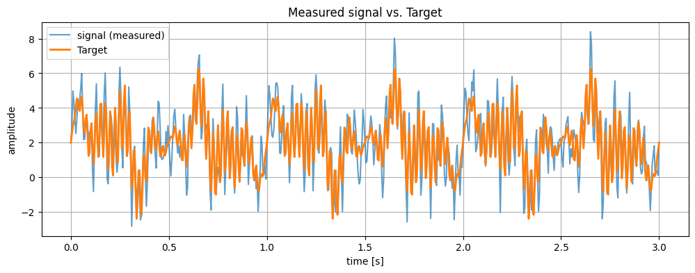
*Figure 1 – Measured signal vs. Target.*

## 2. Data analysis: the DFT

The signal is analysed with the DFT, computed directly from its definition:

$$X[k] = \sum_{n=0}^{N-1} x[n]\, e^{-j 2\pi k n / N}, \qquad k = 0, \dots, N-1$$

Here N = 601 is the number of samples and n is the sample index. Each bin k is a test sinusoid that makes exactly k cycles over the record, at frequency $f_k = k \cdot f_s/N$. The bin spacing is $\Delta f = f_s/N \approx 0.333$ Hz. Because the signal is real, only bins 0 to N/2 (0 to 100 Hz) are needed, and the amplitudes are scaled by 2/N.

Comparing the spectrum of the measured signal with that of the Target separates signal from noise:

| Component | Frequency [Hz] | In Target? |
| --- | --- | --- |
| DC | 0 (level ≈ 2) | yes |
| Low tones | 2, 5, 8 | yes |
| Middle tone (noise) | 25 | no |
| High tones | 40, 42 | yes |

The 25 Hz line has amplitude 1.22 and is absent from the Target, so it is the noise to remove. The small bins around it and around 40–42 Hz are spectral leakage, because the tones do not complete a whole number of cycles in the 3.005 s record. The measured spectrum also shows a low broadband noise floor across 0–100 Hz.

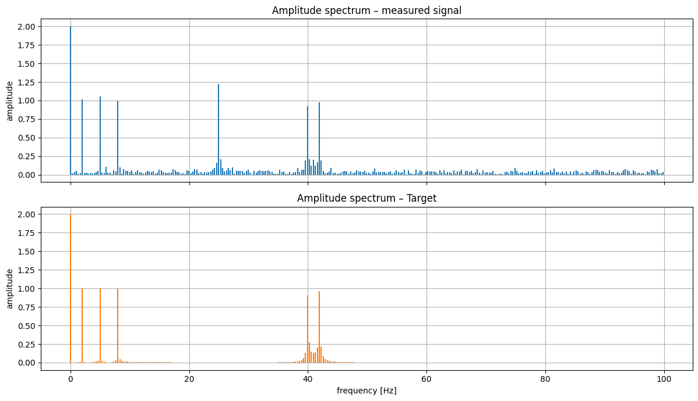
*Figure 2 – Amplitude spectrum of the measured signal (top) and the Target (bottom).*

## 3. Designing the transfer function

### Step 1 – Zeros and poles

A frequency f maps to the angle $\theta = 2\pi f/f_s$ on the unit circle, so the noise at 25 Hz sits at $\theta_0 = \pi/4$ (45°). Two standard placements are used:

- **Zeroing out:** a conjugate pair of zeros *on* the unit circle at $\pm\theta_0$ makes |H| = 0 at 25 Hz.
- **Restoring the pass band:** a conjugate pair of poles at the same angle, just inside the circle at radius r = 0.9, cancels the effect of the zeros away from 25 Hz, so the dip stays narrow. The notch width is roughly $(1 - r) \cdot f_s/\pi \approx 6$ Hz.

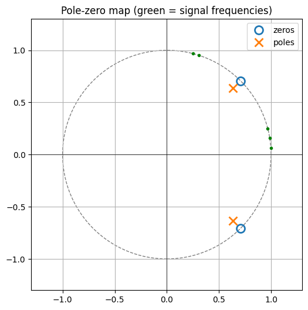

*Figure 3 – Pole-zero map. Green dots mark the signal frequencies.*

### Step 2 – Transfer function

The placement gives H(z) directly in factored form:

$$H(z) = K\,\frac{(z - e^{j\theta_0})(z - e^{-j\theta_0})}{(z - r e^{j\theta_0})(z - r e^{-j\theta_0})}$$

### Step 3 – Amplitude response from distances

On the unit circle, $z = e^{j\omega}$. There, |H| equals the product of the distances from that point to the two zeros, divided by the product of the distances to the two poles. Near 25 Hz the distance to the zero goes to 0. Far from 25 Hz the two distances are almost equal. Because each pole is slightly closer to the circle than its zero, the unscaled pass band sits at about 1.09 instead of 1.

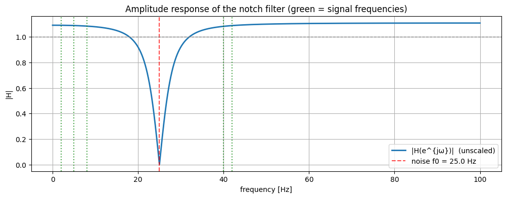
*Figure 4 – Unscaled amplitude response.*

### Step 4 – Scaling

The gain K is chosen so that |H| = 1 at DC (z = 1): K = 1/|H(1)| = 0.9171. The pass band is then 1.000 at 0–8 Hz and about 0.99 at 40–42 Hz, with 0 at 25 Hz.

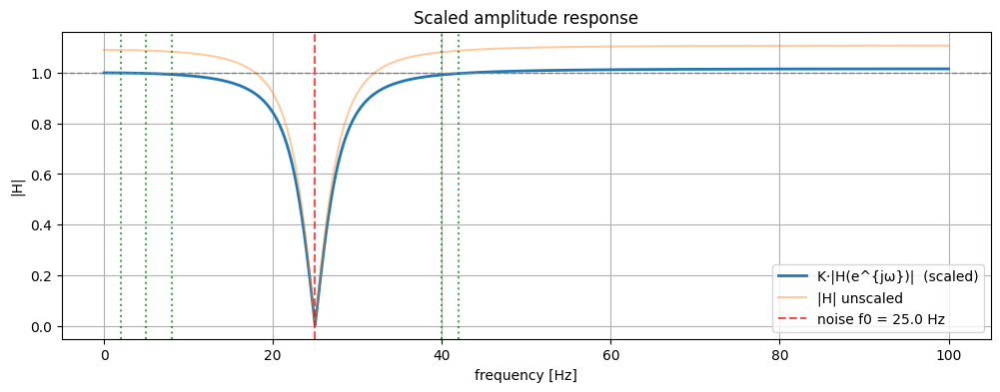
*Figure 5 – Scaled amplitude response (pass band ≈ 1).*

### Step 5 – Coefficients

Multiplying out each conjugate pair cancels the imaginary parts:

$$(z - e^{j\theta_0})(z - e^{-j\theta_0}) = z^2 - 2\cos\theta_0\, z + 1$$

$$(z - re^{j\theta_0})(z - re^{-j\theta_0}) = z^2 - 2r\cos\theta_0\, z + r^2$$

Dividing the numerator and denominator by $z^2$ gives the form in powers of $z^{-1}$:

$$H(z) = K\,\frac{1 - 2\cos\theta_0\, z^{-1} + z^{-2}}{1 - 2r\cos\theta_0\, z^{-1} + r^2 z^{-2}} = \frac{b_0 + b_1 z^{-1} + b_2 z^{-2}}{1 + a_1 z^{-1} + a_2 z^{-2}}$$

| Coefficient | Index 0 | Index 1 | Index 2 |
| --- | --- | --- | --- |
| b (numerator, ×K) | 0.91707 | −1.29693 | 0.91707 |
| a (denominator) | 1 | −1.27279 | 0.81 |

The numerator is symmetric ($b_0 = b_2$) because the zeros lie on the unit circle. Since $a_2 = r^2 < 1$, the poles are inside the circle and the filter is stable.

## 4. Difference equation and filter output

Writing H(z) = Y(z)/X(z), cross-multiplying, and replacing every $z^{-m}$ by a delay of m samples gives the difference equation:

$$y[n] = 0.91707\,x[n] - 1.29693\,x[n-1] + 0.91707\,x[n-2] + 1.27279\,y[n-1] - 0.81\,y[n-2]$$

The filter runs sample by sample over the signal, with all values before n = 0 assumed to be zero ($x[-1] = x[-2] = y[-1] = y[-2] = 0$). The result matches `scipy.signal.lfilter` exactly. Because the input jumps straight to a level of about 2, the poles ring at the start. This transient decays like $0.9^n$ and is gone after about 0.25 s.

After the transient, the output follows the Target closely but is slightly shifted. The 25 Hz line drops from 1.22 to 0.01, while the five signal tones are unchanged. The RMS error against the Target falls from 1.03 to 0.54.

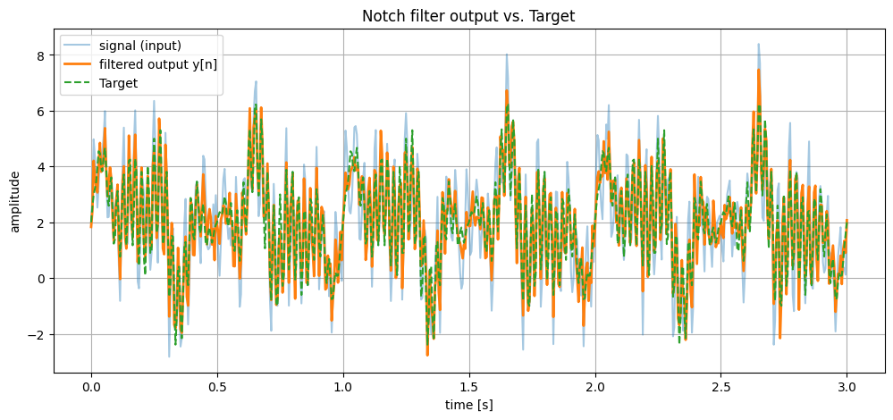
*Figure 6 – Notch filter output vs. input and Target.*

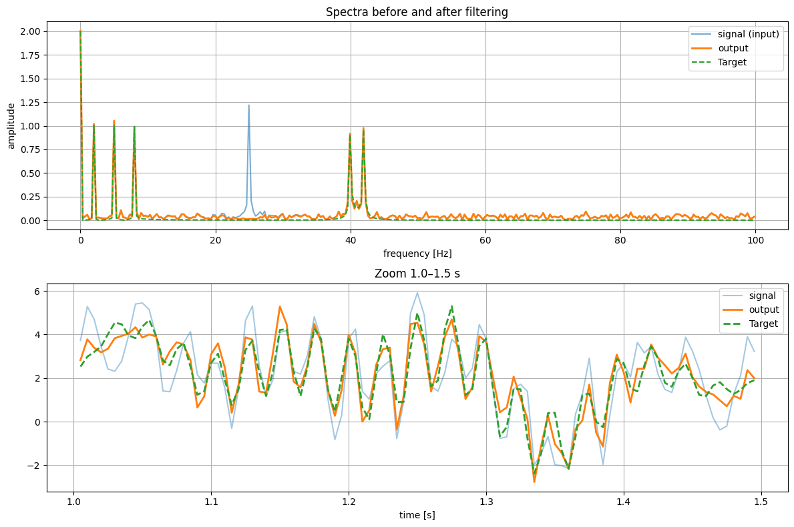
*Figure 7 – Spectra before and after filtering (top) and a zoom on 1.0–1.5 s (bottom).*

## 5. Comparison with Butterworth and Chebyshev II

Two library band-stop filters (`scipy.signal`, as second-order sections) were designed for the same task:

| Filter | Specification | Poles | Zeros on the unit circle |
| --- | --- | --- | --- |
| Pole-zero notch | r = 0.9 at 25 Hz | 2 | 1 pair at 25 Hz |
| Butterworth band-stop | order 2, −3 dB edges 20–30 Hz | 4 | double pair at 25 Hz |
| Chebyshev II band-stop | order 3, 40 dB, stopband edges 23–27 Hz | 6 | 3 pairs at 23.3, 24.9, 26.7 Hz |

For `cheby2`, the frequencies you pass are the stopband edges, not −3 dB points. A 20–30 Hz stopband pushed its transition past 40 Hz and cut that tone to 0.58, so 23–27 Hz was used instead.

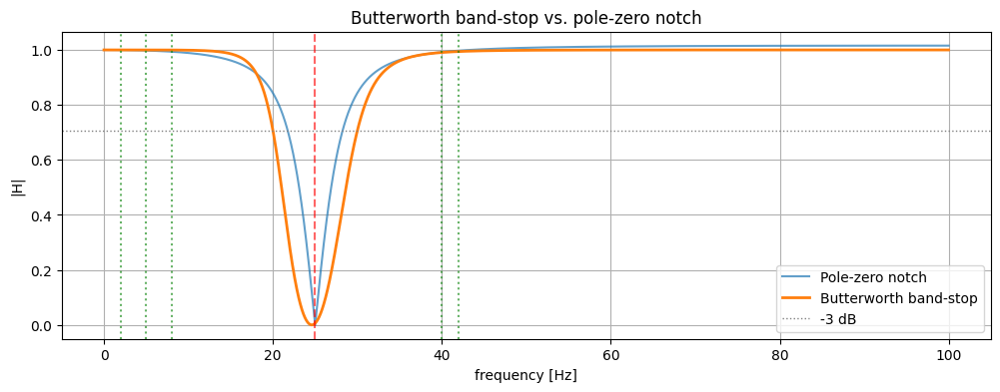
*Figure 8 – Butterworth band-stop vs. the pole-zero notch.*

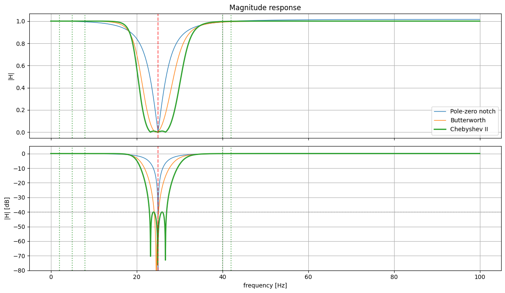
*Figure 9 – Magnitude of all three filters, linear (top) and in dB (bottom).*

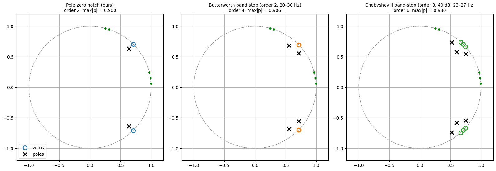
*Figure 10 – Pole-zero maps of the three filters.*

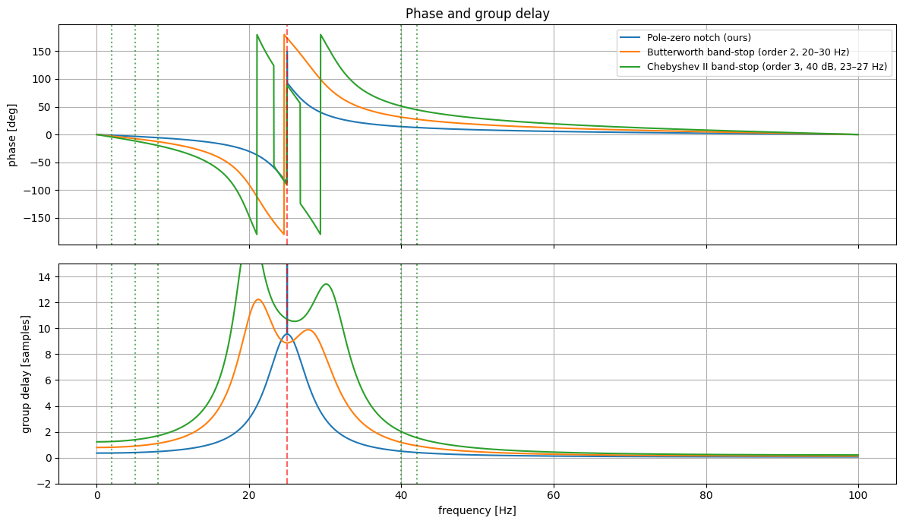
*Figure 11 – Phase and group delay of the three filters.*

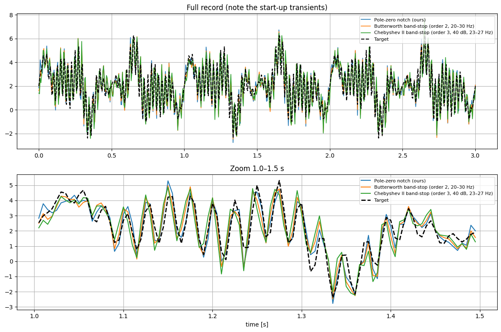
*Figure 12 – Causal filter outputs vs. Target: full record (top) and zoom on 1.0–1.5 s (bottom).*

The error is split into two parts:

- **Noise that passes the filter:** found by filtering signal − Target.
- **Distortion of the clean signal:** found by filtering the Target and comparing the result with the Target itself.

The first 0.5 s is skipped to exclude the transients.

| Filter | Phase at 8 Hz | Phase at 40 Hz | Settling | RMS noise passed | RMS distortion | RMS total |
| --- | --- | --- | --- | --- | --- | --- |
| Pole-zero notch | −6° | +14° | 0.22 s | 0.50 | 0.25 | **0.54** |
| Butterworth | −13° | +31° | 0.19 s | 0.48 | 0.54 | 0.71 |
| Chebyshev II | −20° | +51° | 0.28 s | 0.48 | 0.86 | 0.96 |

The unfiltered signal has an RMS error of 1.03.

To isolate the effect of phase, each filter was also applied with zero-phase filtering (`sosfiltfilt`, which filters forward and then backward). This gives a magnitude of |H|² and zero phase. Both ends are trimmed by 0.5 s here.

| Filter | Causal: distortion | Causal: total | Zero-phase: distortion | Zero-phase: total |
| --- | --- | --- | --- | --- |
| Pole-zero notch | 0.25 | 0.55 | 0.015 | 0.50 |
| Butterworth | 0.54 | 0.71 | 0.015 | 0.48 |
| Chebyshev II | 0.86 | 0.97 | 0.006 | 0.48 |

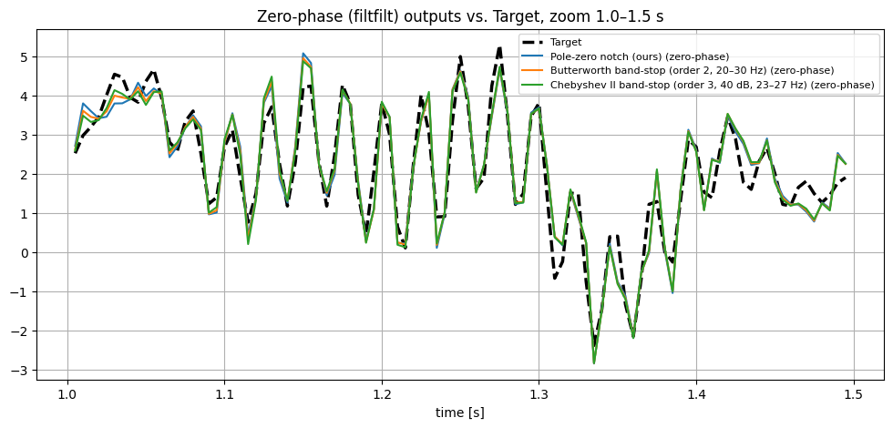
*Figure 13 – Zero-phase outputs vs. Target, zoom on 1.0–1.5 s.*

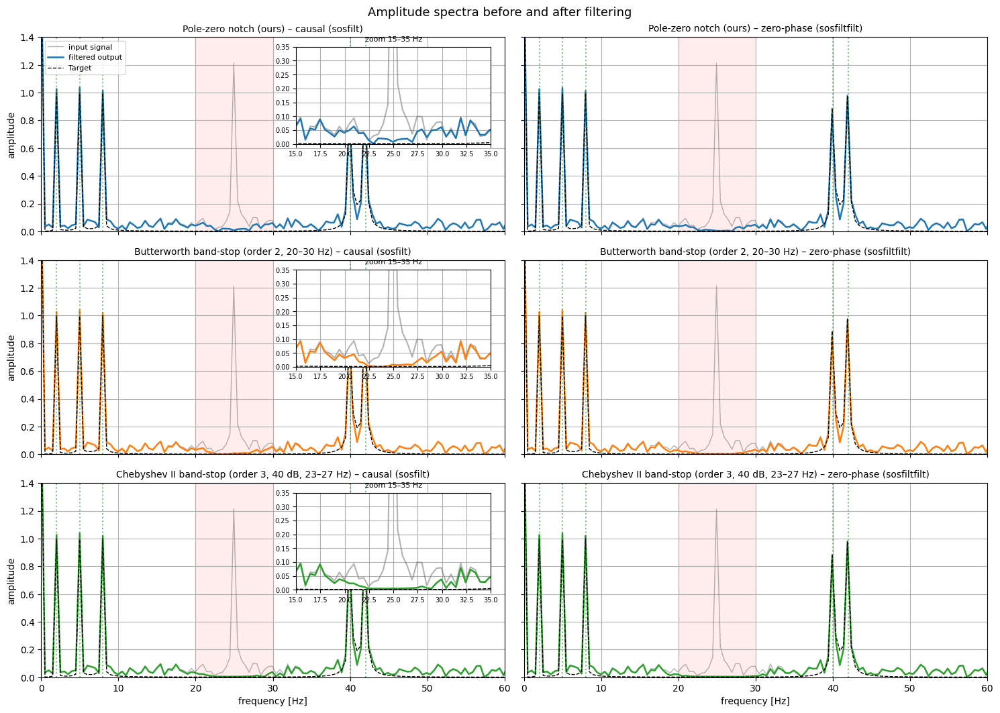
*Figure 14 – Spectra before and after filtering for each filter: causal (left) and zero-phase (right). The insets zoom in on 15–35 Hz.*

## 6. Analysis of the results

**Steepness costs phase.** A steeper or wider stopband brings fast phase changes closer to the signal tones. For a causal filter, a rapid change in magnitude always comes with a rapid change in phase, and the group delay peaks at the band edges (Figure 11). The Chebyshev II, which has the sharpest transitions, shifts the 40 Hz tone by +51°. The notch shifts it by +14°.

**Phase distorts the signal.** Each tone is delayed by a different amount: the low tones lag and the high tones lead. So the output can't be aligned with the Target by a single time shift, and the shape of the waveform changes. The zero-phase test confirms that phase is the main cause of the remaining distortion. Without phase, the distortion drops from 0.25–0.86 to 0.006–0.015 for all three filters.

**A wider stopband doesn't remove more noise.** About 75% of the noise energy lies within 24–26 Hz. Widening the stopband to 20–30 Hz catches only about 3% more. The rest is a broadband floor spread across the whole spectrum, including the signal bands (Figure 14). All three filters therefore pass almost the same amount of noise (RMS 0.48–0.50). No fixed linear filter can remove this floor without also removing signal.

**Conclusion.**
- **Causal (real-time) filtering:** the simple 2nd-order notch performs best, with an RMS error of 0.54. It has the narrowest notch and the least phase distortion.
- **Offline zero-phase filtering:** all three filters reach about 0.48–0.50, and the remaining error is the broadband noise.
- **Going further:** reducing the error below this would need an adaptive filter (for example LMS) with a reference signal.

---

## Running the code

Requirements: Python 3 with `numpy`, `pandas`, `openpyxl`, `matplotlib`, `scipy` and `jupyter`.

```bash
pip install numpy pandas openpyxl matplotlib scipy jupyter
```

Put the Excel data file next to the notebook, or change the file name in cell 1. Then open the notebook and run the cells in order.
