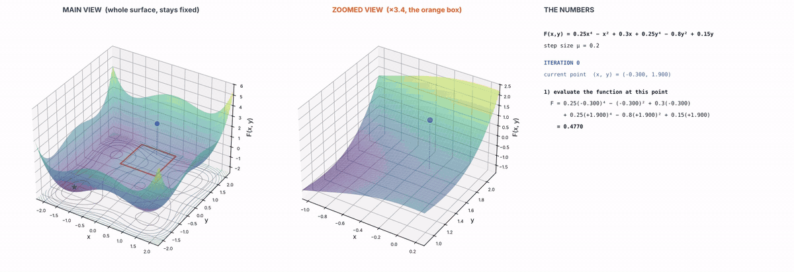
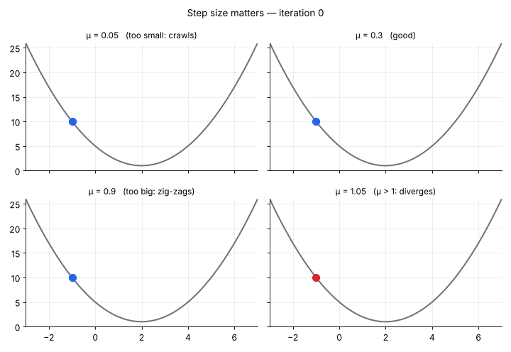
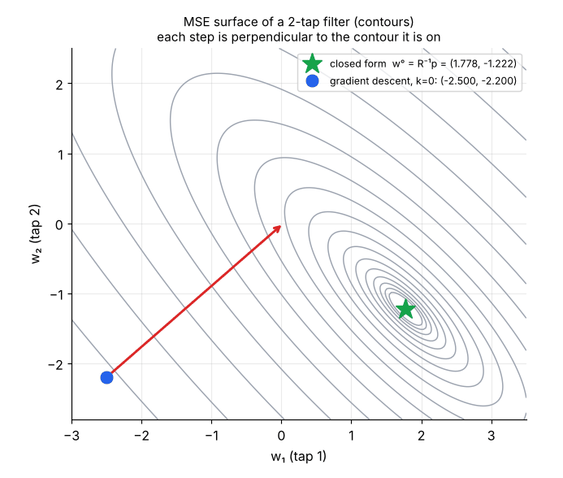

# Intuitive Gradient Descent

## Cost function vs. optimizer

These are two different things:

- **Cost function** $J(\mathbf{w})$: says *how bad* a choice of parameters is (e.g. mean squared error).
- **Optimizer**: a method to *find* the parameters that minimize it. Gradient descent is one.

The analytic way is to set the gradient to zero, $\nabla J = 0$, and solve. That gets expensive with many parameters, and for non-convex costs there is often no closed-form solution at all. Gradient descent avoids solving anything. It just walks downhill:

```
start somewhere
repeat:
    g = slope at the current point
    w = w − μ·g          (step against the slope)
until g ≈ 0
```

## Watch it

```math
F(x,y) = 0.25x^4 - x^2 + 0.3x + 0.25y^4 - 0.8y^2 + 0.15y
```

```math
\frac{\partial F}{\partial x} = x^3 - 2x + 0.3 \qquad \frac{\partial F}{\partial y} = y^3 - 1.6y + 0.15
```

Start at $(-0.3,\ 1.9)$, step size $\mu = 0.2$.



Left: the whole surface, with the path drawn on it. Middle: a close-up of the current step (the orange box in the left view). Right: the numbers being computed.

| k | $(x_k,\ y_k)$ | $F$ | $\partial F/\partial x$ | $\partial F/\partial y$ |
|---|---|---|---|---|
| 0 | (−0.300, 1.900) | 0.4770 | +0.873 | +3.969 |
| 1 | (−0.475, 1.106) | −0.7936 | +1.142 | −0.266 |
| 2 | (−0.703, 1.159) | −1.0939 | +1.359 | −0.146 |
| 3 | (−0.975, 1.189) | −1.4699 | +1.323 | −0.072 |
| 4 | (−1.239, 1.203) | −1.7718 | +0.875 | −0.033 |
| 5 | (−1.414, 1.210) | −1.8782 | +0.299 | −0.015 |
| 6 | (−1.474, 1.213) | −1.8887 | +0.044 | −0.007 |
| 7 | (−1.483, 1.214) | −1.8889 | ≈ 0 | ≈ 0 |

The steps shrink on their own because the slope shrinks near the bottom. It stops in a **local** minimum. The deepest valley (green star) has $F = -2.268$.

## Step size



Too small is slow. Too large overshoots, and past a limit it diverges.

## Non-convex cost


Gradient descent only sees the local slope, so the starting point decides which minimum you reach.

## Hints for DSP and adaptive filtering

**The MSE of an FIR filter is a quadratic bowl** with a single minimum, so the local-minimum problem above does not occur:

```math
J(\mathbf{w}) = \sigma_d^2 - 2\mathbf{p}^T\mathbf{w} + \mathbf{w}^T\mathbf{R}\mathbf{w}, \qquad \nabla J = 2(\mathbf{R}\mathbf{w} - \mathbf{p})
```



- **Closed form:** setting $\nabla J = 0$ gives the Wiener solution $\mathbf{w}^\circ = \mathbf{R}^{-1}\mathbf{p}$ (green star in the animation).
- **Steepest descent:** gradient descent with the true $\mathbf{R}$ and $\mathbf{p}$ (blue path). It is stable for $0 < \mu < 1/\lambda_{\max}$, where $\lambda_{\max}$ is the largest eigenvalue of $\mathbf{R}$.
- **Eigenvalue spread** of $\mathbf{R}$: the larger it is, the more stretched the bowl, and the slower the convergence.
- **LMS:** replace the true gradient with an estimate from the current sample. You get a cheap update for every sample, and it can track signals whose statistics change. This is the basis of adaptive filtering.

**Is gradient descent faster than the closed form?** Only sometimes. `benchmark.py` shows it wins on large problems with a small eigenvalue spread, and loses badly when the spread is large. Its real advantages are that it needs only the gradient and that it works on live data.

## Reproduce

```bash
pip install numpy matplotlib pillow     # plus ffmpeg for the 3-D animation
python make_3d_zoom.py
python make_animations.py
python benchmark.py
```
