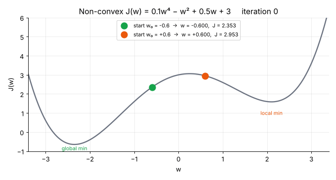

# Gradient Descent, Explained by Watching It Work

> **Assignment 2, Question 1:** give an easier, more intuitive explanation of the gradient descent method.

This page doesn't start with formulas. It picks a cost function, puts numbers into it, and shows each step as an animation. The math comes in only once you've seen the idea.

---

## 1. First, untangle two things that get mixed up

When people first see gradient descent, they often treat **the cost function** and **gradient descent** as one thing. They're two separate pieces:

| | **Cost function** $J(\mathbf{w})$ | **Optimizer** (e.g. gradient descent) |
|---|---|---|
| Question it answers | *How bad* is this choice of parameters? | *How do I find* the parameters that make it least bad? |
| Analogy | The landscape: hills and valleys | The hiker looking for the lowest valley |
| Examples | Mean squared error, mean absolute error, cross-entropy, any energy function | Closed-form solution, gradient descent, Newton's method, LMS, … |

You **choose** the cost function to describe what "good" means for your problem. The optimizer doesn't care what the function means. It only needs to evaluate the function and its slope. So one optimizer works on many different cost functions.

### The "pure math" way of finding the minimum

From calculus: at a minimum the slope is flat.

1. Set the **first** derivative (the gradient) to zero, $\nabla J(\mathbf{w}) = \mathbf{0}$, and solve for $\mathbf{w}$.
2. Use the **second** derivative to check that it's a minimum ($J''>0$, or a positive-definite Hessian), not a maximum or a saddle point.

This works well when you can actually solve step 1. Often you can't:

- **Many parameters**: for a quadratic cost, step 1 is a linear system $\mathbf{R}\mathbf{w}=\mathbf{p}$. Solving it costs about $N^3$ operations, which gets large for big $N$.
- **Non-linear / non-convex costs**: $\nabla J = 0$ may have no closed-form solution at all. Even when it does, it gives you *every* flat point (minima, maxima, saddles), and you still have to sort them out.
- **The cost isn't fully known**: in adaptive filtering you never know the true statistics $\mathbf{R}$ and $\mathbf{p}$ exactly. You only see samples, one at a time.

Gradient descent takes another route. It never solves an equation; it walks downhill one step at a time.

---

## 2. The idea in one sentence

> Stand somewhere, measure which way is downhill, take a small step that way, repeat.

As a loop:

```
pick a starting point w            (any guess, often random)
repeat:
    measure the slope   g = J'(w)   (which way is uphill?)
    step the other way  w = w − μ·g (μ = step size)
until the slope is ~0
```

Why the **minus** sign? The slope points **uphill**. If the slope is negative (going down to the right), then $-\mu g$ is positive and we move right. If the slope is positive, we move left. Either way we head downhill.

Note that **only the starting point is arbitrary**. Every step after that is set by the slope; nothing is random.

---

## 3. Watch it: a 3-D surface, zooming in at every step

Cost function with two parameters and several valleys (local minima):

$$F(x,y) = 0.25x^4 - x^2 + 0.3x + 0.25y^4 - 0.8y^2 + 0.15y$$

$$\frac{\partial F}{\partial x} = x^3 - 2x + 0.3 \qquad \frac{\partial F}{\partial y} = y^3 - 1.6y + 0.15$$

Start: $(x_0, y_0) = (-0.3,\ 1.9)$, step size $\mu = 0.2$

> ### ▶ [Open the interactive version (Previous / Next / Play buttons)](https://shahriarivari.github.io/REPO-NAME/)
> GitHub can't run buttons inside a README, so the step-by-step version is a separate page (`docs/index.html`). Below is the same thing as an animation.


- **Main view (left):** the whole surface. It never moves; only the dots and the path are added as the algorithm runs. The orange box shows where the zoomed view is looking. The green star marks the deepest valley.
- **Zoomed view (middle):** a close-up of the current step, updated once per step. Up close, any smooth surface looks like a flat tilted plane.
- **The numbers (right):** what is being computed at that moment.

Each iteration has three steps:

1. **Evaluate** $F$ at the current point, with the numbers substituted.
2. **Measure the slopes**: substitute the point into $\partial F/\partial x$ and $\partial F/\partial y$. The orange patch in the zoomed view is the tilted plane they describe.
3. **Nudge against the slope**: $x \leftarrow x - \mu\,\partial F/\partial x$, $y \leftarrow y - \mu\,\partial F/\partial y$. The red dashed line is the step. Then repeat from the new point.

The numbers from the animation:

| k | $(x_k,\ y_k)$ | $F(x_k, y_k)$ | $\partial F/\partial x$ | $\partial F/\partial y$ |
|---|---|---|---|---|
| 0 | (−0.300, 1.900) | 0.4770 | +0.873 | +3.969 |
| 1 | (−0.475, 1.106) | −0.7936 | +1.142 | −0.266 |
| 2 | (−0.703, 1.159) | −1.0939 | +1.359 | −0.146 |
| 3 | (−0.975, 1.189) | −1.4699 | +1.323 | −0.072 |
| 4 | (−1.239, 1.203) | −1.7718 | +0.875 | −0.033 |
| 5 | (−1.414, 1.210) | −1.8782 | +0.299 | −0.015 |
| 6 | (−1.474, 1.213) | −1.8887 | +0.044 | −0.007 |
| 7 | (−1.483, 1.214) | −1.8889 | ≈ 0 | ≈ 0 |

<details>
<summary><b>Pause and predict:</b> why do the steps get smaller even though μ never changes? (click)</summary>

The step is $\mu \cdot \nabla F$, and **the slopes shrink as you approach the bottom**. Near a minimum the surface is nearly flat, so the steps get small on their own, and when both slopes are ≈ 0 the point stops moving. You don't have to tell the algorithm to slow down; the flattening surface does it.
</details>

<details>
<summary><b>Pause and predict:</b> did it find the lowest point of the surface? (click)</summary>

No. It stopped at $F = -1.889$, but the deepest valley (green star) is at $(-1.484, -1.309)$ with $F = -2.268$. At the start, $\partial F/\partial y$ was large and positive, so the first step pushed $y$ into the upper valley, and from there every slope points into that valley. Gradient descent only sees the slope where it stands. Section 5 looks at this more closely.
</details>

---

## 4. The step size μ matters

Same function, same start, four values of μ:


- **Too small**: always goes in the right direction, but takes forever.
- **Good**: gets there in a few steps.
- **Too big**: overshoots the bottom and zig-zags across the valley.
- **Way too big**: each overshoot is larger than the last, and it **diverges**.

<details>
<summary><b>Pause and predict:</b> where exactly is the stability limit for this function? (click)</summary>

From the update, $w_{k+1}-2 = (1-2\mu)(w_k-2)$. The error shrinks only if $|1-2\mu|<1$, i.e. $0<\mu<1$.
In general the limit depends on the **curvature** (second derivative) of the cost: a sharply curved valley needs a smaller step. For an $N$-parameter quadratic cost the condition is $0<\mu<1/\lambda_{\max}$, where $\lambda_{\max}$ is the largest eigenvalue of $\mathbf{R}$. You'll meet the same condition again in the **LMS** stability analysis.
</details>

---

## 5. Non-convex cost: where you start decides where you end

$J(w) = 0.1w^4 - w^2 + 0.5w + 3$ has two valleys. Two hikers start just 1.2 apart, on either side of the hill:



This is a point to be honest about. Gradient descent **only knows the local slope**, so on a non-convex cost it finds *a* minimum, not necessarily *the* minimum. It's still the practical tool for these problems, because the alternative, solving $\nabla J=0$ exactly, usually isn't possible here. In practice people use several random starts, momentum, or noise (as in stochastic gradient descent) to escape poor valleys.

> Good news for filtering: the mean-squared-error cost of a linear (FIR) filter is a **quadratic bowl**. It has exactly one minimum, so this problem doesn't occur there.

---

## 6. Two parameters: the MSE surface of a 2-tap filter

This is what gradient descent looks like on the cost function used in adaptive filtering. The mean squared error of a 2-tap FIR filter is

$$J(\mathbf{w}) = \sigma_d^2 - 2\mathbf{p}^T\mathbf{w} + \mathbf{w}^T\mathbf{R}\mathbf{w},\qquad \nabla J = 2(\mathbf{R}\mathbf{w}-\mathbf{p})$$

with $\mathbf{R}=\begin{bmatrix}1&0.8\\0.8&1\end{bmatrix}$ (input autocorrelation) and $\mathbf{p}=[0.8,\ 0.2]^T$ (cross-correlation). Viewed from above, the bowl's contours are ellipses:


- The **green star** is the closed-form answer, the Wiener solution $\mathbf{w}^\circ=\mathbf{R}^{-1}\mathbf{p}$.
- The **blue path** is gradient descent (this version, with exact $\mathbf{R}$ and $\mathbf{p}$, is called *steepest descent*).
- Every step is **perpendicular to the contour** it starts on. "Steepest" literally means that.
- The path first drops quickly across the narrow direction of the ellipse, then crawls along the long direction. The more stretched the ellipse (the larger the **eigenvalue spread** of $\mathbf{R}$), the slower that crawl. This is why eigenvalue spread controls convergence speed in adaptive filters.

---

## 7. So is gradient descent faster than the closed form?

**Sometimes, not always.** Here's a measurement (`benchmark.py`) on a quadratic cost with $N$ parameters. Closed form = `np.linalg.solve(R, p)`; gradient descent runs until it's within $10^{-6}$ of that answer.

| N | eigenvalue spread of R | closed form | gradient descent | GD steps |
|---|---|---|---|---|
| 500 | 2 | 3.9 ms | **1.1 ms** | 12 |
| 500 | 10 | **3.6 ms** | 4.7 ms | 64 |
| 500 | 1000 | **3.6 ms** | 410 ms | 6 421 |
| 2000 | 2 | 128 ms | **18 ms** | 12 |
| 2000 | 10 | 131 ms | **84 ms** | 63 |
| 2000 | 1000 | **131 ms** | 7 571 ms | 6 269 |

*(Single machine, single run. Your numbers will differ, but the pattern holds.)*

What the table shows:

- One gradient step costs about $N^2$ operations; a direct solve costs about $N^3$. So for **large, well-conditioned** problems, gradient descent wins.
- The number of steps grows with the **eigenvalue spread**. On a badly stretched bowl, the closed form wins easily.

Speed is not the main reason to use gradient descent. The main reasons are:

1. **It works when there is no closed form** (non-linear, non-convex costs).
2. **It needs only the gradient**, not a matrix inverse or the full second-derivative matrix.
3. **It can run on live data.** Replace the true gradient $2(\mathbf{R}\mathbf{w}-\mathbf{p})$ with an estimate from the current sample and you get the **LMS algorithm**: one cheap update per sample, which keeps tracking even when the signal statistics change. A one-shot closed-form solution can't do that. This is the whole idea of adaptive filtering.

---

## 8. Summary

| | Closed form ($\nabla J = 0$) | Gradient descent |
|---|---|---|
| Needs | Solve an equation (often a matrix inverse) | Only the slope at the current point |
| Cost | One big computation (~$N^3$) | Many small steps (~$N^2$ each, ~$N$ for LMS) |
| Non-convex costs | Usually impossible to solve | Works, but may stop in a local minimum |
| Changing data | Recompute from scratch | Keeps updating; tracks changes |
| Tuning | None | Step size μ (too big → diverges) |

**Gradient descent in one line:** *measure the slope, step the other way, repeat, letting the flattening slope slow you down as you reach the bottom.*

---

### Reproduce the animations

```bash
pip install numpy matplotlib pillow
python make_3d_zoom.py      # 3-D animation (needs ffmpeg) -> assets/gd_3d_zoom.gif
python make_interactive.py  # interactive page          -> docs/index.html
python make_animations.py   # the other GIFs -> ./assets/
python benchmark.py         # closed form vs gradient descent timing
```
