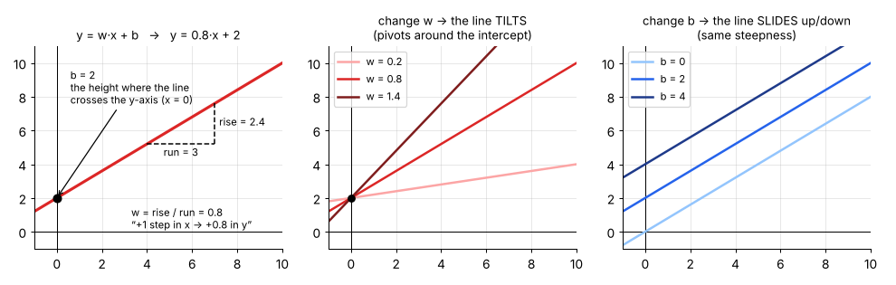
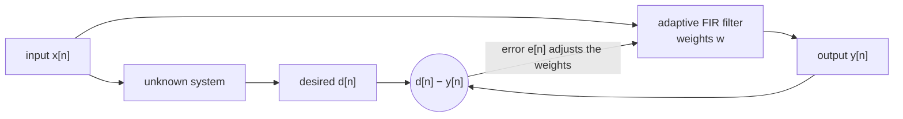
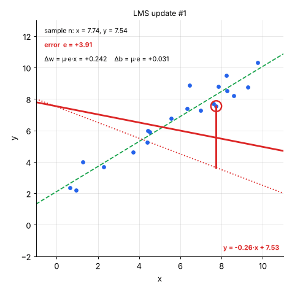
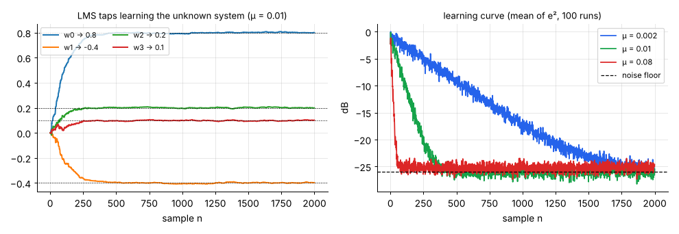
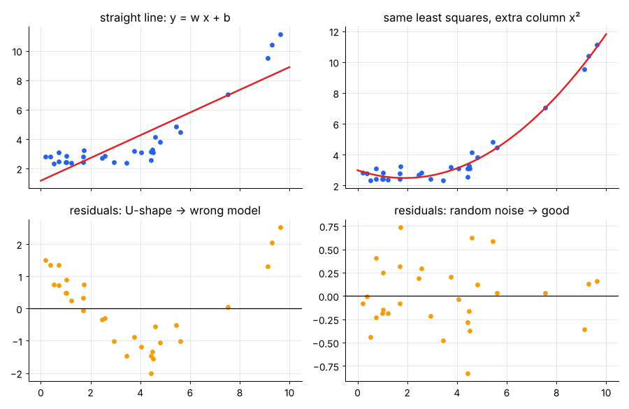

<div align="center">

# 📉 Least Squares, Visually

**How to find the line that best describes your data, from a plain `for` loop to the closed-form solution and the LMS adaptive filter.**


*Each shaded square has area eᵢ². Least squares means **making the total area of the squares as small as possible**.*

</div>

---

## 1. A line has only two knobs: `w` and `b`

$$
y = w \cdot x + b
$$

<div align="center">

</div>

* **`b` (intercept):** the height where the line crosses the y-axis, i.e. the value of y at x = 0. Changing `b` **slides** the line up or down.
* **`w` (slope):** rise ÷ run. Every step of +1 in x moves y by `w`. Changing `w` **tilts** the line.

So *"find the best line"* really means *"find the best two numbers, `w` and `b`"*.

---

## 2. What does "best" mean?

For each data point the line makes a prediction $\hat y_i = w x_i + b$. The miss is the **residual**
$e_i = y_i - \hat y_i$, the vertical gap between the point and the line.

We square every miss (so the signs can't cancel and big misses count more) and average them:

$$
J(w,b) = \frac{1}{N}\sum_{i=1}^{N}\big(y_i - (w x_i + b)\big)^2
$$

$J$ is **one number that tells us how bad a line is**. Least squares means picking the `w` and `b` that make $J$ as small as possible.

> ⚠️ It minimises **vertical** gaps, not the perpendicular distance to the line. Minimising perpendicular distance is *total least squares* (PCA).

---

## 3. Two ways to look at the same line ⭐ *(read this before the animations)*

Every line is just a pair of numbers `(w, b)`. So we can draw each line in **two places**:

<div align="center">

</div>

| Left: **data space** | Right: **parameter space** |
|---|---|
| axes are `x` and `y` | axes are **slope `w`** and **intercept `b`** |
| a line is drawn as a **line** | the same line is drawn as a **single dot** |
| you see how well it fits the points | the background colour is the error $J$ of the line at that spot |

**How to read the right plot.** Think of it as a **map of a valley seen from above**:
* each spot on the map is one possible line,
* the colour is its error (**dark purple = small error**, **yellow = big error**),
* the ★ at the bottom of the valley is **the best line**.

Line **A** is too flat, so its dot sits in a high (lighter) area. Line **B** is far too steep, so it is high up in the yellow region. Line **C** fits well, so it sits at the bottom of the valley.
**When the dot moves on the right, the line changes on the left.** Moving right makes the line steeper, and moving up raises it.

---

## 4. The most intuitive optimiser: a `for` loop that tries everything

```python
best_J = float("inf")
for w in slopes:                       # every candidate slope
    for b in intercepts:               # every candidate intercept
        J = sum((yi - (w*xi + b))**2 for xi, yi in zip(x, y)) / N   # how bad is this line?
        if J < best_J:                 # better than the best so far? keep it
            best_J, best_w, best_b = J, w, b
```

<div align="center">

</div>

**What you are watching:**
* 🔴 **Red** = the line being tried right now. On the left it is a line (with its gaps to the points); on the right it is the red dot. The dot walks through a grid: one column per slope `w`, every intercept `b` in that column.
* 🟢 **Green** = the best line found so far. It only moves when the loop finds a line with a smaller $J$.
* ⚪ **White dots** = all the lines already tried.
* As the red dot gets close to the dark valley floor, the red line hugs the data and $J$ drops.

It works, but the answer is only as precise as the grid, and the work grows like $(\text{grid size})^{\text{number of parameters}}$.
The map shows something useful: the error surface is **one smooth valley**. We can use that shape directly instead of trying everything.

---

## 5. Why there is only **one** best line (convexity)

Keep `b` fixed and look at how the error changes with `w`.
A single data point contributes $(y_i - w x_i - b)^2$. The part inside the brackets is a straight line in `w`, and squaring a straight line gives a **U-shaped parabola**.
The total error $J$ is just the sum of these U-shapes, and **adding U-shapes always gives another U-shape**. Exactly the same happens for `b`.

<div align="center">

</div>

So in every direction, $J$ is a U. Together they form a bowl with **one bottom and no traps** (right panel: the kind of curve we *don't* get). This property is called **convex**.

**The second-derivative check.** A curve bends upward (a U) when its second derivative is positive:

$$
\frac{d^2 J}{d w^2} = 2 \cdot \text{average}(x_i^2), \qquad \frac{d^2 J}{d b^2} = 2
$$

Both are positive **for every** `w` and `b`. The bowl curves upward everywhere, so it can't have a hump or a second dip.

### Finding the bottom directly

At the bottom of the bowl the ground is flat, so the derivative with respect to **both** knobs is zero:

| Condition | What it says | Result |
|---|---|---|
| $\dfrac{\partial J}{\partial b} = 0$ | the misses above and below the line cancel out | $b_{\text{best}} = \bar y - w_{\text{best}}\ \bar x$ |
| $\dfrac{\partial J}{\partial w} = 0$ | the misses are not tilted against $x$ | $w_{\text{best}} = \dfrac{\mathrm{Cov}(x,y)}{\mathrm{Var}(x)}$ |

In words:
* the best line always passes through the **average point** $(\bar x, \bar y)$ of the data,
* its slope is **how much x and y move together, divided by how much x moves on its own**.

No loop and no guessing: one formula gives the exact answer. (With more parameters the same idea becomes one matrix equation, solved in Python by `np.linalg.lstsq(X, y)`.)

---

## 6. Iteratively: gradient descent

Instead of jumping straight to the bottom, we can also **walk downhill**. At every step we look at the slope of the ground and take a small step against it:

$$
w \leftarrow w - \eta \ \frac{\partial J}{\partial w}, \qquad b \leftarrow b - \eta \ \frac{\partial J}{\partial b}
$$

$\eta$ is the step size. If it is too small, the walk is slow. If it is too big, each step overshoots the valley and the error **explodes**.

<div align="center">

</div>

These are the same two views as before. We start at one line (□ *start*) and keep stepping **downhill** on the map, so the line on the left gets a little better with every step. The dashed green line is the target.

The path rushes down the steep side, then **crawls** along the long, flat valley floor. The valley is a thin ellipse because changing `w` affects the error much more than changing `b`.
Centring the data ($x \to x - \bar x$) makes the valley round and the walk much faster.

Why walk at all if a formula exists? Because the formula needs **all the data at once**. In signal processing the data often arrives **one sample at a time**, and that is exactly the next step.

---

## 7. From least squares to **LMS** (Least *Mean* Squares) — the adaptive filter

### 7.1 The setting: an adaptive filter

In DSP we often have a system whose behaviour we don't know (an acoustic echo path, a communication channel, 50 Hz mains hum leaking into an ECG). We want a filter that **learns it by itself, while the signal is running**.



The filter is an FIR filter with $M$ taps. At time $n$ it looks at the last $M$ input samples:

$$
\mathbf{x}[n] = \big[\ x[n],\ x[n-1],\ \dots,\ x[n-M+1]\ \big]^T, \qquad y[n] = \mathbf{w}^T \mathbf{x}[n] = \sum_{k=0}^{M-1} w_k\ x[n-k]
$$

$$
e[n] = d[n] - y[n]
$$

**This is the same problem as fitting our line.** The line $\hat y = w x + b$ is an adaptive filter with 2 weights, $\mathbf{w} = [w,\ b]$, and input $\mathbf{x} = [x,\ 1]$.

### 7.2 Why "Least *Mean* Squares"?

* **Least squares** minimises the **sum** of squared errors over a fixed batch of data we already have.
* For a signal that keeps running there is no fixed batch. Instead we minimise the **expected (mean)** squared error:

$$
J(\mathbf{w}) = \mathbb{E}\big[e^2[n]\big]
$$

This is still the same convex bowl, now over $M$ weights. Its exact bottom is the **Wiener solution** $\mathbf{w}_{\text{opt}} = \mathbf{R}^{-1}\mathbf{p}$, where $\mathbf{R}$ is the autocorrelation matrix of the input and $\mathbf{p}$ is the cross-correlation between the input and $d[n]$.
It is the statistical twin of our closed-form formula: Var(x) becomes $\mathbf{R}$ and Cov(x,y) becomes $\mathbf{p}$.

The problem is that in real time we **don't know** $\mathbf{R}$ and $\mathbf{p}$, and inverting $\mathbf{R}$ every sample would be far too expensive.

### 7.3 The LMS trick (Widrow & Hoff, 1960)

1. Use gradient descent on the bowl: $\ \mathbf{w} \leftarrow \mathbf{w} - \eta\ \nabla J$.
2. The true gradient is $\nabla J = -2\ \mathbb{E}\big[e[n]\ \mathbf{x}[n]\big]$, which needs that unknown expectation.
3. **The trick:** drop the expectation and use the current sample only, $\ \nabla J \approx -2\ e[n]\ \mathbf{x}[n]$. It is a noisy guess, but correct on average.
4. Put it into step 1 and absorb the 2 into the step size $\mu$:

$$
\boxed{\ \mathbf{w}[n+1] = \mathbf{w}[n] + \mu\ e[n]\ \mathbf{x}[n]\ }
$$

**The whole algorithm, run once per new sample:**

```python
y = w @ x_vec            # 1. filter output         (M multiplications)
e = d - y                # 2. error
w = w + mu * e * x_vec   # 3. nudge every weight    (M multiplications)
```

How to read the update: **error × input**. If the error is large and a tap's input was large, that tap was probably responsible, so it gets corrected most. When the error is zero, nothing changes.

### 7.4 Watching it learn

Back to our line, updated one data point at a time:

<div align="center">


*Red circle = the single sample used for this update · dashed green = the exact least-squares line*
</div>

A real DSP case, **system identification**. The unknown system is an FIR filter $h = [0.8,\ -0.4,\ 0.2,\ 0.1]$, driven by white noise, with a little measurement noise added:

<div align="center">

</div>

* **Left:** the 4 LMS weights find the unknown system on their own, with no matrix inversion.
* **Right:** the **learning curve**, the squared error averaged over 100 runs. This shows the key trade-off of the step size $\mu$:
  * 🔵 small $\mu$ is **slow**, but ends very close to the noise floor,
  * 🔴 large $\mu$ is **fast**, but ends slightly *above* the floor because the weights keep jittering (this extra error is called **misadjustment**),
  * if $\mu$ is too large it **diverges**. Rule of thumb: keep $\mu$ below $\dfrac{2}{M \cdot P_x}$, where $P_x$ is the input power.

### 7.5 The family at a glance

| | Least Squares | Wiener filter | **LMS** | RLS |
|---|---|---|---|---|
| Minimises | sum of e² over a batch | mean of e² | mean of e² (noisy estimate) | weighted sum of e² |
| Needs | all data at once | true statistics R, p | nothing, just the current sample | the past data, summarised recursively |
| Cost per sample | — (one big solve) | — (one big solve) | about 2M multiplications | about M² multiplications |
| Converges | exact, one shot | exact | slowly, keeps jittering | fast |
| Tracks a changing system | ❌ | ❌ | ✅ | ✅ |

**Where LMS is used:** echo cancellation in phones and video calls, channel equalisation in modems, active noise cancelling headphones, and removing 50 Hz hum from biomedical signals (an adaptive notch filter).

---

## 8. When the data is **not** linear

Least squares will always give you *a* line, even a useless one. **Check the residuals:** if they show a pattern, the model is wrong.

<div align="center">

</div>

**"Linear" means linear in the parameters, not in $x$.** Adding a column $x^2$ to $X$ gives a parabola fit that is *still* ordinary, convex least squares.

### Recommendations
1. **Plot the data and the residuals** before trusting $R^2$.
2. **Transform the features:** $x^2,\ \log x,\ \sin(\omega x)$. You still have the same convex least squares.
3. **Transform the target** for multiplicative laws: $y = ae^{kx} \Rightarrow \ln y = \ln a + kx$.
4. **Use splines or piecewise models** when the behaviour changes from one region to another.
5. **Use non-linear least squares** (`scipy.optimize.curve_fit`, Levenberg–Marquardt) when parameters sit inside the function, e.g. $Ae^{-t/\tau}$. It is no longer convex, so a good initial guess matters.
6. **Guard against overfitting:** check the error on held-out data, or use ridge regression $(X^TX+\lambda I)^{-1}X^Ty$.
7. **Deal with outliers:** use Huber loss or RANSAC.

---

## Run it yourself

```bash
pip install -r requirements.txt
jupyter notebook least_squares_explained.ipynb   # full step-by-step notebook
python make_animations.py                        # regenerate every GIF in assets/
```

```
├── README.md
├── least_squares_explained.ipynb   # theory + code, cell by cell
├── make_animations.py              # builds all GIFs/figures
├── requirements.txt
└── assets/                         # generated animations
```

<div align="center"><sub>Made as part of the Master of Smart Systems, Hanze University of Applied Sciences, Groningen.</sub></div>
