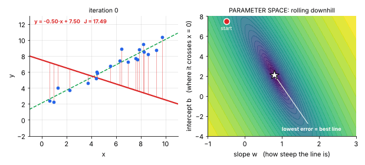

<div align="center">

# 📉 Least Squares, Visually

**How to find the line that best describes your data, from a plain `for` loop to the closed-form solution and the LMS adaptive filter.**


*Each shaded square has area eᵢ². Least squares means **making the total area of the squares as small as possible**.*

</div>

---

## 1. A line has only two knobs: `w` and `b`

$$
y = w \cdot x + b
$$

<div align="center">

</div>

* **`b` (intercept):** the height where the line crosses the y-axis, i.e. the value of y at x = 0. Changing `b` **slides** the line up or down.
* **`w` (slope):** rise ÷ run. Every step of +1 in x moves y by `w`. Changing `w` **tilts** the line.

So *"find the best line"* really means *"find the best two numbers, `w` and `b`"*.

---

## 2. What does "best" mean?

For each data point the line makes a prediction $\hat y_i = w x_i + b$. The miss is the **residual**
$e_i = y_i - \hat y_i$, the vertical gap between the point and the line.

We square every miss (so the signs can't cancel and big misses count more) and average them:

$$
J(w,b) = \frac{1}{N}\sum_{i=1}^{N}\big(y_i - (w x_i + b)\big)^2
$$

$J$ is **one number that tells us how bad a line is**. Least squares means picking the `w` and `b` that make $J$ as small as possible.

> ⚠️ It minimises **vertical** gaps, not the perpendicular distance to the line. Minimising perpendicular distance is *total least squares* (PCA).

---

## 3. Two ways to look at the same line ⭐ *(read this before the animations)*

Every line is just a pair of numbers `(w, b)`. So we can draw each line in **two places**:

<div align="center">

</div>

| Left: **data space** | Right: **parameter space** |
|---|---|
| axes are `x` and `y` | axes are **slope `w`** and **intercept `b`** |
| a line is drawn as a **line** | the same line is drawn as a **single dot** |
| you see how well it fits the points | the background colour is the error $J$ of the line at that spot |

**How to read the right plot.** Think of it as a **map of a valley seen from above**:
* each spot on the map is one possible line,
* the colour is its error (**dark purple = small error**, **yellow = big error**),
* the ★ at the bottom of the valley is **the best line**.

Line **A** is too flat, so its dot sits in a high (lighter) area. Line **B** is far too steep, so it is high up in the yellow region. Line **C** fits well, so it sits at the bottom of the valley.
**When the dot moves on the right, the line changes on the left.** Moving right makes the line steeper, and moving up raises it.

---

## 4. The most intuitive optimiser: a `for` loop that tries everything

```python
best_J = float("inf")
for w in slopes:                       # every candidate slope
    for b in intercepts:               # every candidate intercept
        J = sum((yi - (w*xi + b))**2 for xi, yi in zip(x, y)) / N   # how bad is this line?
        if J < best_J:                 # better than the best so far? keep it
            best_J, best_w, best_b = J, w, b
```

<div align="center">

</div>

**What you are watching:**
* 🔴 **Red** = the line being tried right now. On the left it is a line (with its gaps to the points); on the right it is the red dot. The dot walks through a grid: one column per slope `w`, every intercept `b` in that column.
* 🟢 **Green** = the best line found so far. It only moves when the loop finds a line with a smaller $J$.
* ⚪ **White dots** = all the lines already tried.
* As the red dot gets close to the dark valley floor, the red line hugs the data and $J$ drops.

It works, but the answer is only as precise as the grid, and the work grows like $(\text{grid size})^{\text{number of parameters}}$.
The map shows something useful: the error surface is **one smooth valley**. We can use that shape directly instead of trying everything.

---

## 5. Why it is a convex bowl (the second derivative)

$$
\frac{\partial J}{\partial w} = -\frac{2}{N}\sum e_i x_i,\qquad
\frac{\partial J}{\partial b} = -\frac{2}{N}\sum e_i,\qquad
H = 2\begin{bmatrix}\overline{x^2} & \bar x\\ \bar x & 1\end{bmatrix}
$$

* The Hessian $H$ is **constant**, so the curvature is the same everywhere and $J$ is an exact quadratic bowl.
* $\det H = 4\,\mathrm{Var}(x) > 0$ and $\partial^2 J/\partial w^2 > 0$, so $H$ is **positive definite**. That means **strictly convex**: one minimum and no traps.

### Closed form (set the gradient to zero)

$$
w^* = \frac{\mathrm{Cov}(x,y)}{\mathrm{Var}(x)}, \qquad b^* = \bar y - w^*\bar x
\qquad\Longleftrightarrow\qquad
X^TX\,\theta = X^Ty \;\Rightarrow\; \theta^* = (X^TX)^{-1}X^Ty
$$

Because $J$ is exactly quadratic, **one Newton step** $\theta - H^{-1}\nabla J$ lands on $\theta^*$ from *any* starting point.

---

## 6. Iteratively: gradient descent

$$
\theta \leftarrow \theta - \eta\,\nabla J(\theta), \qquad \text{stable if } \eta < 2/\lambda_{\max}(H)
$$

<div align="center">

</div>

Same two views as before. Instead of trying everything, we start at one line (□ *start*) and keep stepping **downhill** on the map. Each step makes the line on the left a little better. The dashed green line is the target.
The path rushes down the steep wall, then **crawls** along the flat valley.
The bowl is a thin ellipse (condition number ≈ 220), so the intercept $b$ converges slowly.
Centring the data ($x \to x - \bar x$) makes the ellipse round and convergence much faster.

---

## 7. Bridge to adaptive filtering: LMS

Use the gradient of **one sample at a time** instead of all $N$ (Widrow–Hoff, 1960):

$$
e[n] = y[n] - (w\,x[n] + b), \qquad w \leftarrow w + \mu\,e[n]\,x[n], \qquad b \leftarrow b + \mu\,e[n]
$$

<div align="center">


*Red circle = the single sample used for this update · dashed green = the exact least-squares line*
</div>

It uses the same cost and the same bowl, but takes cheap, noisy steps. LMS never settles exactly and keeps jittering around the LS solution. A smaller $\mu$ gives less jitter but slower convergence.

| | Least Squares | LMS |
|---|---|---|
| Data per update | all $N$ points | 1 sample |
| Result | exact, one shot | keeps jittering around the exact answer |
| Tracks a changing system | ❌ | ✅ |

---

## 8. When the data is **not** linear

Least squares will always give you *a* line, even a useless one. **Check the residuals:** if they show a pattern, the model is wrong.

<div align="center">

</div>

**"Linear" means linear in the parameters, not in $x$.** Adding a column $x^2$ to $X$ gives a parabola fit that is *still* ordinary, convex least squares.

### Recommendations
1. **Plot the data and the residuals** before trusting $R^2$.
2. **Transform the features:** $x^2,\ \log x,\ \sin(\omega x)$. You still have the same convex least squares.
3. **Transform the target** for multiplicative laws: $y = ae^{kx} \Rightarrow \ln y = \ln a + kx$.
4. **Use splines or piecewise models** when the behaviour changes from one region to another.
5. **Use non-linear least squares** (`scipy.optimize.curve_fit`, Levenberg–Marquardt) when parameters sit inside the function, e.g. $Ae^{-t/\tau}$. It is no longer convex, so a good initial guess matters.
6. **Guard against overfitting:** check the error on held-out data, or use ridge regression $(X^TX+\lambda I)^{-1}X^Ty$.
7. **Deal with outliers:** use Huber loss or RANSAC.

---

## Run it yourself

```bash
pip install -r requirements.txt
jupyter notebook least_squares_explained.ipynb   # full step-by-step notebook
python make_animations.py                        # regenerate every GIF in assets/
```

```
├── README.md
├── least_squares_explained.ipynb   # theory + code, cell by cell
├── make_animations.py              # builds all GIFs/figures
├── requirements.txt
└── assets/                         # generated animations
```

<div align="center"><sub>Made as part of the Master of Smart Systems, Hanze University of Applied Sciences, Groningen.</sub></div>
