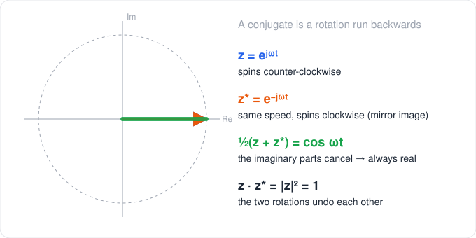
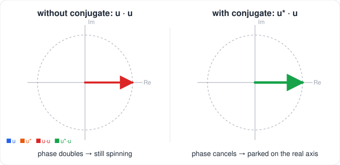
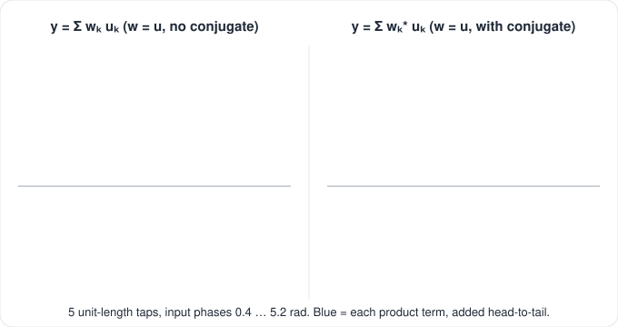

# Why is there a complex conjugate on FIR filter weights?

> **Slide 17, Linear Filter Structures (Adaptive Filters):**
> the output of a transversal (FIR) filter is written as
>
> $$y(n) = \sum_{k=0}^{M-1} w_k^{*}\, u(n-k)$$
>
> where $^{*}$ is the complex conjugate, $w_k$ is the tap weight and $z^{-1}$ is the delay element.
> **Why do we so often see the conjugate on the coefficients?**

**Short answer:** writing the output as $y(n) = \mathbf{w}^H \mathbf{u}(n)$ makes the filter an **inner product**, which measures how much the input *looks like* the weight vector. The conjugate **undoes the rotation** in the weights, so a perfectly matched input adds up coherently and gives a real, positive result. You can build exactly the same set of filters without it. The conjugate is a convention, but it is the one that keeps the math clean: lengths, correlations, the Wiener solution and the LMS update all come out in their simplest form.

The rest of this page tells the story step by step.

---

## 1. Complex numbers are rotations

Write any complex number in polar form:

$$z = r\,e^{j\theta}$$

Multiplying by $z$ does two things: it **scales** by $r$ and **rotates** by $\theta$. A phasor $e^{j\omega t}$ is a point going around the unit circle at angular speed $\omega$.

So "complex arithmetic" is mostly **bookkeeping of rotations**.

## 2. The conjugate is the same rotation, run backwards

$$z^{*} = r\,e^{-j\theta}$$

Same length, opposite angle: the mirror image across the real axis. If $z = e^{j\omega t}$ spins counter-clockwise, $z^{*}$ spins clockwise at the same speed.

<p align="center"></p>

Two things follow directly from the picture:

| Operation | Result | Meaning |
|---|---|---|
| $z + z^{*}$ | $2\,\mathrm{Re}\{z\}$ | imaginary parts cancel, the result is real |
| $z \cdot z^{*}$ | $\lvert z\rvert^2$ | the two rotations cancel, only the length is left |

And the general case, which is the key to everything below:

$$a\,b^{*} = \lvert a\rvert\,\lvert b\rvert\; e^{\,j(\theta_a - \theta_b)}$$

**Multiplying by a conjugate keeps the magnitudes but subtracts the phases.** It answers the question *"how far is $a$ rotated relative to $b$?"*

## 3. You have already met it many times

The pattern "multiply by the conjugate to compare or to measure" shows up wherever complex numbers carry phase.

**Fourier transform.** The DTFT

$$X(e^{j\omega}) = \sum_n x(n)\, e^{-j\omega n} = \sum_n x(n)\,\big(e^{j\omega n}\big)^{*}$$

is the input multiplied by the **conjugate** of a probe phasor $e^{j\omega n}$. If $x(n)$ contains a component rotating at $\omega$, the conjugate un-rotates it and all its samples add up in the same direction, giving a big peak. Components at other frequencies keep spinning and average out. The Fourier coefficient is an inner product: "how much does $x$ look like $e^{j\omega n}$?"

**Energy and power spectrum.** $\lvert X\rvert^2 = X X^{*}$, and the energy of a signal is $\sum_n x(n)x^{*}(n)$. Without the conjugate, $x^2$ is complex and can even be zero for a non-zero signal.

**AC circuits (complex power).** In phasor analysis $S = V I^{*} = P + jQ$. The conjugate cancels the common phase reference, so only the **phase difference** between voltage and current remains, and that difference sets real power versus reactive power. $V I$ without the conjugate depends on where you put the time origin, which is physically meaningless.

**Correlation.** $r_{xy}(l) = \sum_n x(n+l)\, y^{*}(n)$. You are asking how well $x$ lines up with $y$ at lag $l$, so you un-rotate one against the other.

Same mechanism every time: **conjugate = un-rotate = compare phases**.

## 4. Why it has to be that way: lengths must be real and positive

For real vectors, $\mathbf{w}^T\mathbf{w} = \sum w_k^2$ is the squared length. Try the same thing with a complex vector:

$$\mathbf{w} = \begin{bmatrix} 1 \\ j \end{bmatrix}, \qquad \mathbf{w}^T\mathbf{w} = 1 + j^2 = 0$$

A non-zero vector with zero "length" is nonsense. The fix is the Hermitian (conjugate) transpose:

$$\mathbf{w}^H\mathbf{w} = \sum_k w_k^{*} w_k = \sum_k \lvert w_k\rvert^2 = 2$$

This is why the inner product on $\mathbb{C}^M$ is **defined** as

$$\langle \mathbf{u}, \mathbf{w}\rangle = \mathbf{w}^H\mathbf{u} = \sum_k w_k^{*} u_k$$

It is the only way to keep the familiar properties: $\langle\mathbf{w},\mathbf{w}\rangle \ge 0$, a real norm, orthogonality, projections and the Cauchy–Schwarz inequality.

The picture below shows the same thing for a single number. On the left, $u \cdot u$ doubles the phase and keeps spinning. On the right, $u^{*} \cdot u$ cancels the phase and stays on the positive real axis.

<p align="center"></p>

## 5. Back to the FIR filter

Stack the taps and the delay line into vectors:

$$\mathbf{w} = \begin{bmatrix} w_0 & w_1 & \cdots & w_{M-1}\end{bmatrix}^T, \qquad \mathbf{u}(n) = \begin{bmatrix} u(n) & u(n-1) & \cdots & u(n-M+1)\end{bmatrix}^T$$

Then the slide's equation is simply

$$\boxed{\,y(n) = \sum_{k=0}^{M-1} w_k^{*}\,u(n-k) = \mathbf{w}^H\mathbf{u}(n) = \langle \mathbf{u}(n), \mathbf{w}\rangle\,}$$

At each time instant the filter computes **an inner product** between what is in the delay line and the weight vector. That one view explains the three reasons the conjugate is there.

### Reason 1: the output measures how much the input looks like $\mathbf{w}$

By Cauchy–Schwarz, $\lvert\mathbf{w}^H\mathbf{u}\rvert \le \lVert\mathbf{w}\rVert\,\lVert\mathbf{u}\rVert$, with equality when $\mathbf{w} \propto \mathbf{u}$. So **if you want the filter to respond most strongly to a signal $\mathbf{s}$, you set $\mathbf{w} = \mathbf{s}$.** This is the matched filter, and with the conjugate convention the weights literally *look like* the signal they are matched to.

Each tap's conjugate un-rotates its sample, so every product $w_k^{*}u_k$ points the same way and they add head-to-tail:

<p align="center"></p>

Five unit-size taps: with the conjugate the output is $5$, the maximum possible. With the same weights but no conjugate, the phases double instead of cancelling and the terms partly cancel, giving $0.31$.

This is exactly how a **beamformer** works: if an antenna array sees a plane wave with steering vector $\mathbf{a}(\theta)$, choosing $\mathbf{w} = \mathbf{a}(\theta)$ gives $\mathbf{w}^H\mathbf{a}(\theta) = M$, a coherent sum aimed at that direction. You "point" the filter by writing down the thing you want to point at.

### Reason 2: it is still an ordinary convolution

Nothing exotic happens to the filter itself. Define $h_k = w_k^{*}$; then

$$y(n) = \sum_{k=0}^{M-1} h_k\,u(n-k)$$

which is the finite convolution sum from the slide. **Any FIR filter can be written either way**, so the conjugate does not restrict what you can build. It only decides whether you store $h_k$ or its conjugate as "the weight". For real signals and real weights $w_k^{*} = w_k$ and the question disappears completely; this is why you never saw it in the basic DSP course.

### Reason 3: adaptive filter math comes out clean

In adaptive filtering we minimise the mean-square error with

$$e(n) = d(n) - \mathbf{w}^H\mathbf{u}(n), \qquad J(\mathbf{w}) = E\big[\,\lvert e(n)\rvert^2\big] = E\big[e(n)\,e^{*}(n)\big]$$

The cost has to be **real** to minimise it, which already needs a conjugate. Expanding:

$$J(\mathbf{w}) = \sigma_d^2 - \mathbf{w}^H\mathbf{p} - \mathbf{p}^H\mathbf{w} + \mathbf{w}^H\mathbf{R}\,\mathbf{w}, \qquad \mathbf{R} = E[\mathbf{u}\mathbf{u}^H],\quad \mathbf{p} = E[\mathbf{u}\,d^{*}]$$

Setting the (Wirtinger) gradient with respect to $\mathbf{w}^{*}$ to zero gives the familiar results with no stray conjugates:

| | With conjugate, $y = \mathbf{w}^H\mathbf{u}$ |
|---|---|
| Wiener–Hopf equation | $\mathbf{R}\,\mathbf{w}_o = \mathbf{p}$ |
| LMS update | $\mathbf{w}(n+1) = \mathbf{w}(n) + \mu\,\mathbf{u}(n)\,e^{*}(n)$ |

These look exactly like the real-valued formulas, with $^T$ replaced by $^H$. That is the main reason textbooks such as Haykin's *Adaptive Filter Theory* use this convention throughout.

## 6. What if we did not use the conjugate?

Suppose we write $y(n) = \mathbf{w}^T\mathbf{u}(n) = \sum_k w_k\,u(n-k)$ instead. Redoing the same derivation:

| | $y = \mathbf{w}^H\mathbf{u}$ (with conjugate) | $y = \mathbf{w}^T\mathbf{u}$ (without) |
|---|---|---|
| Output as inner product | yes, $\langle\mathbf{u},\mathbf{w}\rangle$ | no, it is $\langle\mathbf{u},\mathbf{w}^{*}\rangle$ |
| Matched-filter weights for signal $\mathbf{s}$ | $\mathbf{w} = \mathbf{s}$ | $\mathbf{w} = \mathbf{s}^{*}$ |
| Wiener–Hopf equation | $\mathbf{R}\,\mathbf{w}_o = \mathbf{p}$ | $\mathbf{R}^{*}\,\mathbf{w}_o = \mathbf{p}^{*}$ |
| Optimal weights | $\mathbf{w}_o = \mathbf{R}^{-1}\mathbf{p}$ | $(\mathbf{R}^{-1}\mathbf{p})^{*}$ |
| LMS update | $\mathbf{w} \leftarrow \mathbf{w} + \mu\,\mathbf{u}\,e^{*}$ | $\mathbf{w} \leftarrow \mathbf{w} + \mu\,\mathbf{u}^{*}\,e$ |
| Filter output and MSE | identical | identical |

So nothing breaks: **the optimum filter is the same, and the weights are just the complex conjugates of each other.** The conjugate does not disappear; it moves into $\mathbf{R}^{*}$, $\mathbf{p}^{*}$ and $\mathbf{u}^{*}$, where it is harder to read. Putting it on the weights once, in the output equation, means every formula afterwards matches its real-valued counterpart and every weight vector can be read as "the pattern this filter is looking for".

The script [`conjugate_demo.py`](conjugate_demo.py) checks all of this numerically:

```text
w^T w = 0j
w^H w = (2+0j)
|sum w_k u_k|  = 0.30526403779155736
|sum w_k* u_k| = 5.0
w^H-convention weights: [ 0.126+0.535j -0.132-0.361j  0.64 -1.304j  0.105-0.947j]
w^T-convention weights: [ 0.126-0.535j -0.132+0.361j  0.64 +1.304j  0.105+0.947j]
are they conjugates?    True
same output?            True
```

## 7. Summary

1. A complex number is a rotation; its **conjugate is the same rotation in reverse**.
2. Multiplying by a conjugate **subtracts phases**, so $a\,b^{*}$ compares $a$ with $b$ and $z\,z^{*}$ gives a real length.
3. That is why the conjugate appears in the Fourier transform, power ($S = VI^{*}$), correlation and energy, and why the complex inner product is $\mathbf{w}^H\mathbf{u}$.
4. Writing the FIR output as $y(n) = \mathbf{w}^H\mathbf{u}(n)$ makes the filter an **inner product**: it un-rotates each sample so matched inputs add up coherently, and the weights look like the signal they detect.
5. It is a **convention, not a constraint**. With $h_k = w_k^{*}$ it is the usual convolution, and dropping it only conjugates the optimal weights. Keeping it makes the Wiener–Hopf equation and the LMS update look exactly like their real-valued versions.
